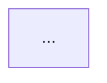

# Templates and exit checklists

Read only the section for the phase you are about to draft. Sections marked *(Medium+)* or *(Large)* can be written as `N/A — <reason>` for smaller tiers.

Contents
1. Common document header
2. DISCOVERY.md
3. PRD.md
4. MVP.md
5. TRD.md (lightweight)
6. USER_FLOW.md (UX: flows and wireframes)
7. DESIGN_SYSTEM.md
8. SCHEMA.md
9. DECISIONS.md
10. TRACEABILITY.md
11. STATUS.md
12. LLD.md (optional)
13. HLD.md (on request)
14. Existing-project additions

---

## 1. Common document header

Every phase document starts with:

```markdown
# <Document title> — <Project name>

| Field | Value |
|---|---|
| Status | Draft / Awaiting approval / Approved (YYYY-MM-DD) |
| Version | 1.0 |
| Owner | <developer name or "Developer"> |
| Depends on | <approved docs this builds on, with versions> |
| Related decisions | D-0xx, D-0xx |
```

Bump the minor version for clarifications, the major version when a change alters scope or design.

---

## 2. DISCOVERY.md

```markdown
## The idea in one paragraph
## Problem
## Users and approximate scale
## Current workaround and its pain points
## Project type
Personal / internal tool / commercial product / other — and new build or extending an existing system
## Platforms
Web / mobile / desktop / API / CLI / other
## Existing systems and integrations
## Success looks like
<measurable where possible>
## Known facts
## Assumptions
## Constraints
- Timeline:
- Budget:
- Team and skills / preferred technologies:
- Hosting / platform:
- Legal, regulatory, security or data requirements:
## Maturity
Prototype / MVP / Production
## Tier
Small / Medium / Large — <one-line reason>
## Open questions
```

**Exit checklist**
- [ ] Problem stated in one or two sentences without naming a solution
- [ ] Every user type named, with rough scale
- [ ] Known facts and assumptions kept separate; constraints answered by the developer (not assumed)
- [ ] Platforms identified (decides whether Phases 4–5 apply)
- [ ] Tier chosen with a reason
- [ ] Decisions logged (tier, maturity, any early constraints)

---

## 3. PRD.md

```markdown
## Product overview
## Problem statement
## Target users and personas
<2–4 short personas: who, goal, frustration>
## Goals
## Non-goals and explicit exclusions
## Core use cases
## User roles
| ID | Role | Description | Key needs |
## Functional requirements
| ID | Requirement (observable behaviour) | Role(s) | Priority (Must/Should/Could) |
## Non-functional requirements
| ID | Category | Requirement (measurable) |
Categories to consider: performance, availability, security, privacy, accessibility, offline, localisation, scalability.
## Business rules and edge cases
| ID | Rule |
## External integrations and dependencies
## Data sensitivity, accessibility and compliance
## Success criteria
| Metric | Target | How measured |
## Assumptions
## Risks
## Open questions
```

**Exit checklist**
- [ ] Every FR is testable (someone could write a pass/fail check for it)
- [ ] NFRs have numbers or concrete thresholds, or say N/A with a reason
- [ ] Non-goals listed
- [ ] Business rules came from the developer, not invented
- [ ] No technology choices in the PRD (requirements, not solutions)
- [ ] No vague requirements left ("fast", "secure", "easy") without a measurable target
- [ ] Success criteria are measurable
- [ ] IDs assigned; TRACEABILITY.md started with all FRs/NFRs as rows

---

## 4. MVP.md

```markdown
## v1 in one sentence
## Release goal
Validation / demonstration / internal adoption / paying customers — target date, team size
## Core assumptions v1 validates
## Requirement classification
| FR | Must / Should / Could / Out of scope for v1 | Reason |
## In scope — user stories
| ID | As a <role>, I want <action> so that <outcome> | FR | Acceptance criteria |
## Out of scope for v1
| ID | Item | Why it's out |
## Later list
## Definition of Done
## Build order, milestones and estimates
| Milestone | Slices / stories | Depends on | Demonstrable outcome | Estimate (range) |
Estimate assumptions and biggest uncertainty:
## Change-request rule
New ideas go to the Later list unless the developer swaps something out of v1; every swap is a D-entry.
```

**Exit checklist**
- [ ] Every Must FR is covered by a story or explicitly moved out with a reason
- [ ] Out-of-scope list is non-empty and specific
- [ ] Acceptance criteria are checkable
- [ ] Slices are each independently demonstrable, with dependencies stated
- [ ] Estimates are ranges with assumptions and the main uncertainty
- [ ] Scope size sanity-checked against the timeline from Discovery
- [ ] No technology choices (feasibility doubts noted as risks for the TRD)

---

## 5. TRD.md (lightweight, MVP-scoped)

Design only for MVP in-scope stories. Keep each section short; for Small/Medium projects most sections are a few lines or a small table.

```markdown
## Scope of this TRD
Covers MVP v<x> stories US-.. to US-... Out-of-scope items are not designed here.
## Stack options considered
| Option | Summary | Pros | Cons | Fit for v1 |
Chosen: Option X — see D-0xx
## Architecture overview
<Mermaid diagram>
## Components
| ID | Component | Responsibility | Serves (US / FR / NFR) |
## High-level data model
| ID | Entity | Key attributes | Relationships | Serves (US) |
Full schema is Phase 6.
## API contracts (v1)
| ID | Method + path (or operation) | Purpose | Auth | Serves (US) |
Request/response shapes for non-obvious endpoints.
## Authentication and authorisation
Approach, session/token handling, role checks. (Or N/A — reason)
## Payments
Provider, flow, webhooks, refunds, idempotency. (Or N/A — reason)
## Integrations
## Hosting, environments and deployment
## Security requirements
Secrets, input validation, relevant OWASP risks, data protection.
## Key technical constraints and risks
## Testing approach
## Future considerations
Only "one-way door" notes: v1 choices that would make Later items expensive. No designs.
## Deferred to TRD expansion (after v1)
Scaling, reliability, observability depth, design for Later items.
## Open questions
```

**Exit checklist**
- [ ] At least two stack options compared (unless the developer fixed the stack — then logged as a developer decision)
- [ ] Every component, entity and endpoint serves an in-scope US; nothing designed for out-of-scope items
- [ ] Every in-scope US is supported by some component/endpoint
- [ ] Every NFR relevant to v1 is addressed
- [ ] Auth and payments either specified or N/A with reason
- [ ] Each significant choice has a D-entry with origin
- [ ] Short enough to read in one sitting for this tier

---

## 6. USER_FLOW.md (UX: flows and wireframes)

For a CLI, replace screens with commands and wireframes with sample terminal output. For a project with no UI, this file isn't written (phase marked `not applicable`).

````markdown
## UX inputs
- Target devices: mobile-first / desktop-first / both
- Navigation preference:
- Accessibility needs (baseline WCAG AA):
- Existing branding:
- UI references:
- Desired complexity:
## Journey maps
### J-01 <name>  (Stories: US-..)
| Stage | User goal | Action | Screen | Possible friction / drop-off |
## Screen inventory
| ID | Screen | Purpose | Roles | States (empty/loading/error/success) | Stories |
## Screen-to-screen flows

## Navigation structure
## Wireframes
### S-01 <screen name>  (Stories: US-..; Journeys: J-..)
```
+--------------------------------------+
| ShelfShare            [My loans] [≡] |
+--------------------------------------+
| [ Search tools near you......... ]   |
|                                      |
| +----------+  +----------+           |
| | [photo]  |  | [photo]  |           |
| | Drill    |  | Ladder   |           |
| | Good     |  | Fair     |           |
| +----------+  +----------+           |
|                                      |
|          ( + List a tool )           |
+--------------------------------------+
```
Notes: what's primary on the screen, what each control does, which state this shows.
Other states: empty — "No tools near you yet" + List a tool button; error — retry banner.
## Edge and error paths
````

Wireframe conventions: `[ Button ]` or `( Primary action )` for buttons, `[ ...... ]` for inputs, `[photo]` for images, `[≡]` for a menu, `( ) / (•)` for radios, `[ ] / [x]` for checkboxes. Keep widths around 40 characters for mobile and about 70 for desktop. Show layout and content only — no colours or fonts.

**Exit checklist**
- [ ] UX inputs answered by the developer or marked as assumptions
- [ ] Every in-scope story appears in at least one journey
- [ ] Every screen is reachable and has empty/loading/error states considered
- [ ] Every screen on a primary journey has a wireframe
- [ ] Destructive actions have confirmation or undo
- [ ] No screen, control or wireframe element exists for an out-of-scope item

---

## 7. DESIGN_SYSTEM.md

```markdown
## Direction
Chosen visual direction — see D-0xx
## Tokens
### Colour  (name | light | dark | usage | contrast pair & ratio)
### Typography  (role | family | size | weight | line-height)
### Spacing scale
### Radii, borders, shadows
### Breakpoints
## Components
| ID | Component | Variants | States | Used on screens |
Per component: anatomy, behaviour, accessibility notes.
## Accessibility rules
Contrast (WCAG AA minimum), focus visibility, hit target size, motion, labels.
## Content and tone
```

**Exit checklist**
- [ ] Every component is used by at least one screen in USER_FLOW.md
- [ ] Text/background pairs meet WCAG AA contrast
- [ ] Every interactive component defines focus, disabled and error states
- [ ] Tokens are named by role, not by raw value

---

## 8. SCHEMA.md

```markdown
## Engine
<from TRD, D-0xx>
## Entity-relationship diagram
```mermaid
erDiagram
  ...
```
## Tables
### T-01 <table>  (Needed by: FR-.., US-..)
| Column | Type | Null | Default | Key/Index | Notes |
Constraints:
## Relationships
| From | To | Cardinality | On delete |
## Permissions
| Table | Role | Read | Create | Update | Delete | Row rule |
## Retention and deletion
## Migrations and seed data
```

**Exit checklist**
- [ ] Every table is needed by an FR/US; no orphan tables or columns
- [ ] Every piece of data shown on a screen has a source column
- [ ] On-delete behaviour matches the PRD business rules
- [ ] Permissions defined for every role in the PRD
- [ ] Indexes cover the queries the flows imply

---

## 9. DECISIONS.md

```markdown
# Decision log — <Project name>

### D-001 — <short title>
- Date: YYYY-MM-DD
- Phase: Discovery / PRD / MVP / TRD / User Flow / Design System / Schema
- Type: product / technical / scope / gate / risk-acceptance / process
- Origin: developer / recommendation-accepted / recommendation-overridden / existing
- Options considered: A) … B) … C) …
- Decision: …
- Rationale: … (developer's words where given; otherwise Claude's stated rationale, noted as "accepted without further comment")
- Recommendation (if any): …
- Consequences / trade-offs: …
- Traces to: FR-.., US-..
- Owner: <developer>
- Status: active / superseded by D-0xx
- Supersedes: D-0xx (if any)
```

Gate entries can be short: date, phase, "Approved PRD v1.0", owner.

---

## 10. TRACEABILITY.md

```markdown
| Requirement | Description | Stories | Components | API | Screens | UI comps | Tables | Status |
|---|---|---|---|---|---|---|---|---|
| FR-01 | … | US-01 | C-01 | API-02 | S-02 | UI-03 | T-01 | in v1 |
| FR-07 | … | OUT-02 | — | — | — | — | — | out of v1 |

## Orphans
## Gaps
```

---

## 11. STATUS.md (status and handoff)

```markdown
# Status — <Project name>

## Summary
<2–3 lines: what it is, for whom> · Tier: Small / Medium / Large

## Where we are
Current phase: <n — name>
Next action: <one line>

| # | Phase | File | Status | Version | Approved on | Notes |
|---|---|---|---|---|---|---|
| 0 | Discovery | DISCOVERY.md | approved | 1.0 | YYYY-MM-DD | |
| 1 | PRD | PRD.md | awaiting input | 0.2 | | waiting on business rules |
| 5 | Design System | DESIGN_SYSTEM.md | not applicable | | | API only, no UI |
| 7 | LLD (optional) | LLD.md | skipped (D-0xx) | | | simple CRUD, design at build time |
...
Statuses: not started · in progress · awaiting input · awaiting approval · approved · blocked · skipped (D-0xx) · not applicable · expanding

## Approved scope
MVP.md v<x> — <one line>
## Stack
<one line, once TRD approved — D-0xx>
## Key decisions
D-0xx <title> · D-0xx <title>
## Accepted risks and open questions
## Documents
| Doc | Version | Status |
```

---

## 12. LLD.md (optional — complex parts only)

````markdown
## Parts covered
| ID | Part | Why it qualifies | Stories | Components |
Parts deliberately not covered: <list> — simple enough to design at build time.

## LLD-01 <part name>
### Purpose
### Module structure
```
<package/module tree>
```
| Class / interface | Responsibility |
### Sequence diagrams
```mermaid
sequenceDiagram
  ...
```
(Happy path and at least one failure path.)
### State machine (if the part has a lifecycle)

| From | Event | To | Guard / rule | Side effects |
### Rules and validation
| ID | Rule | Enforced where |
### Edge cases, errors and retries
| Case | Expected behaviour |
### Idempotency and concurrency
### Worked example
<realistic sample data walked through the flow>
````

**Exit checklist**
- [ ] Every covered part traces to in-scope stories and TRD components
- [ ] Every lifecycle has a state machine with every transition's guard and side effects
- [ ] Every critical flow has a sequence diagram including a failure path
- [ ] Double-submit and simultaneous-request behaviour is defined
- [ ] Worked example matches the rules and the schema
- [ ] No contradictions with TRD or SCHEMA (or a change was logged)

---

## 13. HLD.md (on request — generated, not designed)

```markdown
# High Level Design — <Project name>
Generated from: PRD v<x>, MVP v<x>, TRD v<x>, SCHEMA v<x> on YYYY-MM-DD. Do not edit by hand; regenerate when sources change.

## Overview and goals
## v1 scope
## Architecture
<Mermaid diagram>
## Components
## Technology stack
## Integrations
## Data model summary
## Security approach
## Deployment
## Key decisions
| ID | Decision | Why |
## Out of scope for v1 and future direction
## Source documents
```

---

## 14. Existing-project additions

Add these to the templates above when the project already has code.

**Every phase document**: add a `Basis` row to the header (`As-built` / `Proposed` / `As-built + proposed`), label statements about the current system `[code]` (with file path), `[inferred]` or `[confirmed]`, and end with:

```markdown
## Findings
### FND-01 — <short title>
- Evidence: <file paths, or what disagrees with what>
- Impact: …
- Status: open / fix later (change request) / accepted (D-0xx) / resolved
```

**DISCOVERY.md**: add after the idea section:

```markdown
## Mode
Document what exists / Plan new work / Both — D-0xx
## Code survey
Stack and versions · structure · routes and APIs · screens · data · integrations · tests · CI and deployment · existing docs · git history
Coverage: <what was read in full, what was sampled, what wasn't read>
```

**MVP.md**: add a `State` column (`shipped` / `partial` / `not built`) to the requirement classification and to user stories.

**TRACEABILITY.md**: use `shipped`, `partial`, `not built` or `proposed` in the Status column.

**STATUS.md**: add under Summary:

```markdown
Mode: Document what exists / Plan new work / Both
Scope: <whole repo, or the areas and paths covered>
Baseline commit: <short hash the as-built docs describe>
## Open findings
FND-01 <title> (<document>) · FND-02 <title> (<document>)
```

**Exit checklist additions** (every as-built document)
- [ ] Statements about the current system are labelled, and `[code]` labels have a file path
- [ ] Spot-checked against the code before presenting; nothing describes behaviour that wasn't seen
- [ ] Unknown rationale is written as unknown, not invented
- [ ] Disagreements between code, documents and the developer are recorded as findings
- [ ] No application code was changed
